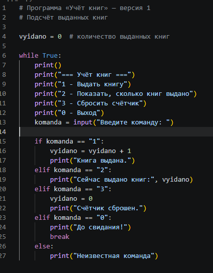
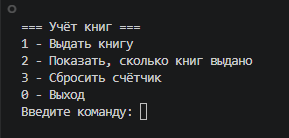
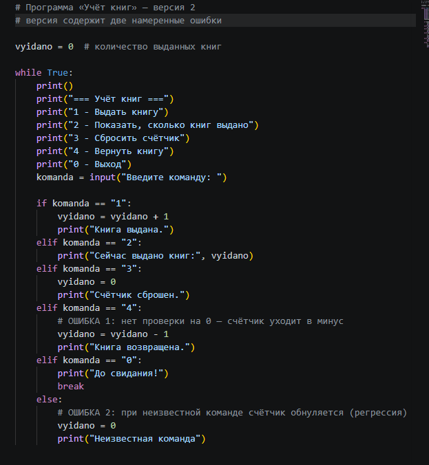
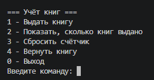

# учёт книг

простая консольная программа на python для подсчёта выданных книг.


## что делает проект

программа показывает меню и ждёт команду. счётчик выданных книг хранится в памяти
и меняется по командам пользователя. при неизвестной команде выводится сообщение
«неизвестная команда», счётчик при этом не должен меняться.

есть две версии:

- app_v1.py — базовая версия: выдача, просмотр, сброс, выход. работает корректно. 


- app_v2.py — добавлена команда возврата книги. содержит 2 намеренных дефекта


## как запустить

нужен python. нажмите на пуска программы или  в терминале из папки проекта выполнить:

``` bash
python app_v1.py

